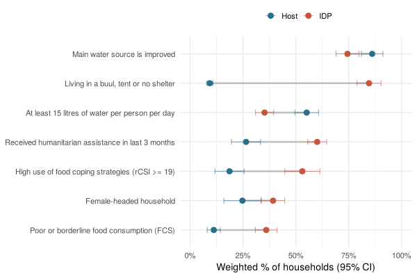
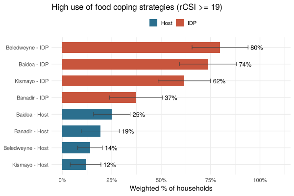

# Somalia household survey pipeline: from KoboToolbox export to weighted dashboard


A reproducible R pipeline for a humanitarian **household needs assessment**. It takes a raw KoboToolbox export through **data-quality checks, a documented cleaning log, survey weighting and design-based analysis**, and ends with an interactive **R Shiny dashboard**.

> **All data in this repository are synthetic.** `R/00_simulate_kobo_data.R` generates them. No real respondents are included. The design mirrors a typical multi-sector needs assessment in Somalia: 4 districts × IDP and host communities.



## Why this project

Field survey data are never clean, and unweighted percentages can be badly wrong. In this sample, the unweighted estimate of households living in a buul, tent or no shelter is **48.5%**. The design-weighted estimate is **31.4%**, because IDP households are over-sampled relative to their share of the population. This pipeline makes every cleaning decision traceable and every estimate design-correct.

## Pipeline

```
KoboToolbox export (raw CSV)
  └─ 01_clean.R            checks → cleaning log → apply → verify
       └─ 02_weight_and_analyse.R   indicators → weights → svydesign → estimates + 95% CI
            └─ app/app.R            R Shiny dashboard
```

| Step | What happens |
| --- | --- |
| **Extract** | Reads the Kobo-style CSV export and the population frame |
| **Quality checks** | Duplicate submissions, interviews under 15 minutes, IQR outliers (log scale), logic errors (e.g. more under-5s than household members), "other, specify" answers |
| **Cleaning log** | Each flag gets a decision (`remove_survey`, `remove_duplicate`, `change_response`, `blank_response`, `no_action`), saved to `outputs/cleaning_log.csv` |
| **Verification** | `verify_cleaning()` confirms every logged change was applied and no removed survey remains |
| **Indicators** | WFP Food Consumption Score, reduced Coping Strategies Index, water source and quantity (15 L/person/day), shelter, assistance received |
| **Weighting** | Stratified two-stage cluster design. Weight = households in stratum ÷ households interviewed. Weighted totals are checked against the population frame |
| **Analysis** | `survey::svydesign(ids = ~cluster_id, strata = ~strata, weights = ~weight)` with `svymean` / `svyby` for proportions and 95% confidence intervals |
| **Dashboard** | Overview cards, IDP and host comparison, breakdown by district or stratum, data-quality tab with a searchable cleaning log |

## Results from the synthetic run

| | |
| --- | --- |
| Raw submissions | 774 |
| Surveys after cleaning | 754 |
| Cleaning-log entries | 56 (6 duplicates, 14 rushed interviews, 6 outliers, 9 logic errors, 21 "other" recodes) |



## How to run

```r
install.packages(c("dplyr", "tidyr", "readr", "survey", "shiny", "bslib", "ggplot2", "DT"))
```

From the project folder:

```bash
Rscript run_all.R            # simulate -> clean -> weight -> analyse
```

```r
shiny::runApp("app")         # open the dashboard
```

To use a real Kobo export, replace `data/raw/kobo_export_synthetic.csv` and the population frame, then adjust the variable names in `R/functions.R`.

## Repository structure

```
R/
  functions.R                  reusable check, cleaning, indicator and weighting functions
  00_simulate_kobo_data.R      synthetic Kobo export and population frame
  01_clean.R                   quality checks, cleaning log, verification
  02_weight_and_analyse.R      indicators, weights, design-based estimates
app/app.R                      R Shiny dashboard
outputs/                       cleaning log, cleaning summary, weighted results
docs/                          figures used in this README
run_all.R                      runs the full pipeline
```

## Author

**Abdullahi Abdisalam Mohamed** · Data Analyst, public-health and humanitarian data
GitHub: [@abdallla-99](https://github.com/abdallla-99) · Email: abdallagarweyne9@gmail.com
